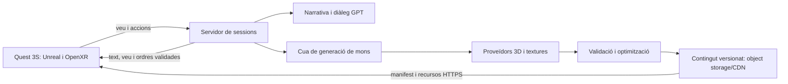

# Quest Generative — mons que creixen amb la teva veu

Projecte col·laboratiu de Pol Barreiro Font per crear un joc de realitat virtual per a **Meta Quest 3S**, amb **Unreal Engine** i contingut descarregable generat al servidor.

> Estat: disseny inicial. Encara no hi ha un joc compilable, servidor desplegat ni generador 3D integrat. Aquest README defineix el projecte i les primeres tasques verificables.

## La idea

El jugador parla pel micròfon: «Vull explorar un bosc amb un castell i parlar amb el seu guardià». El servidor interpreta la petició, prepara un món amb objectes i textures, crea personatges i narrativa, i publica contingut compatible amb les ulleres. El client descarrega el contingut i executa la simulació, les interaccions i les animacions.

Volem que la història continuï amb les decisions del jugador, que els personatges responguin per veu i text, i que la comunitat pugui crear proveïdors, contingut i eines sense dependre d'un únic servei.

## Arquitectura proposada



| Component | Responsabilitat |
| --- | --- |
| Client Unreal | Seguiment VR, entrada, micròfon, locomoció, interaccions, renderitzat, memòria cau i estat de càrrega |
| Servidor | Autenticació, sessions, persistència del món, quotes, coordinació de generació i API |
| Narrativa | Diàleg, missions, textos i decisions estructurades; adaptador GPT substituïble |
| Generació | Adaptadors 3D/textures, tasques asíncrones, reutilització i cancel·lació |
| Publicació | Validació, límits de recursos, procedència, llicències, versions i descàrrega |

### Contingut que es pot carregar

Un mapa d'Unreal no es pot carregar simplement com un fitxer de l'editor descarregat d'una web. Proposarem dues vies i les validarem amb un prototip en dispositiu:

1. **MVP:** manifest JSON que compon escenes amb un catàleg d'objectes, materials i animacions inclòs al client. Permet generar mons sense recompilar cada escena.
2. **Contingut nou:** recursos 3D amb un importador compatible en execució, o paquets preparats amb el procés de *cooking* per Android i la mateixa versió del client. Cal provar compatibilitat, materials, col·lisions i rendiment abans d'adoptar formats o plugins.

El manifest haurà d'incloure versió d'esquema, versió compatible del client, identificador del món, recursos amb mida i SHA-256, procedència/llicència, transformacions, col·lisions, personatges i referències de narrativa. Les URL vindran de dominis autoritzats. Una signatura autenticada establirà la confiança; el hash només comprova la integritat. Instal·lació atòmica, límits de mida i retorn a la versió anterior si falla la descàrrega.

### Veu, personatges i moviments

La integració de joc serà amb una **API al servidor**. ChatGPT Work i Codex poden ajudar a desenvolupar i operar el projecte, però aquest disseny no pressuposa que el client pugui connectar-se directament a un xat de la subscripció.

Les claus permanents no s'inclouran a l'APK. La veu podrà passar pel servidor o usar credencials temporals si el transport ho permet. Primer integrarem text simulat; després transcripció, diàleg i àudio amb un adaptador real.

GPT proposarà accions d'un conjunt permès, com parlar, caminar a una destinació o reproduir un gest. Unreal resoldrà navegació, físiques, locomoció i animacions. No executarem codi generat pel model ni descarregarem scripts arbitraris. La generació de noves animacions i el retargeting queden per a una fase posterior.

## Primer prototip i criteris d'acceptació

- [ ] Contracte de manifest versionat, exemples i validador amb proves de dades invàlides.
- [ ] Servidor simulat sense claus ni serveis de pagament: publicar i consultar un món petit.
- [ ] Projecte Unreal/OpenXR: escena base amb locomoció còmoda, interacció i pantalla de càrrega.
- [ ] Descarregar un manifest i construir una escena amb el catàleg local.
- [ ] Provar a Quest 3S: objectiu inicial de 72 FPS estables, memòria i temps de càrrega mesurats; objectiu subjecte a validació.
- [ ] Davant falta de xarxa, conservar la sala base i oferir reintent/cancel·lació.
- [ ] NPC amb text i estat persistent; després micròfon, veu i interrupció de resposta.
- [ ] Provar un objecte 3D nou descarregat, amb límits i verificació de confiança.
- [ ] Publicar una versió reproduïble i una guia de prova en dispositiu.

La versió d'Unreal, SDK Android, NDK i plugin Meta/OpenXR es fixarà després de comprovar la matriu de compatibilitat. No hi ha suport de plataforma declarat sense una compilació i prova reals. Evitarem assumir que funcionalitats gràfiques d'escriptori són adequades per al dispositiu.

## Desenvolupament obert

Estructura prevista, encara pendent d'implementar:

```text
quest-generative/
  README.md
  LICENSE
  CONTRIBUTING.md
  client/         # projecte Unreal i codi propi
  server/         # sessions, API, quotes i adaptadors
  contracts/      # esquemes compartits
  examples/       # mons petits amb llicència compatible
  docs/          # decisions, configuració i proves Quest
```

Consulta [CONTRIBUTING.md](CONTRIBUTING.md). Fem servir Issues per propostes i errors, i Pull Requests petites amb explicació i verificació. Són benvingudes aportacions en català, castellà o anglès: codi, disseny, narrativa, accessibilitat, models, textures i proves amb ulleres.

Les decisions tècniques es documentaran amb alternatives i motiu. Cap proveïdor de pagament serà imprescindible per executar les proves del servidor simulat. Les claus i dades personals no es pujaran a GitHub.

## Núvol, costos i continuïtat

GitHub serà la font compartida del projecte. El servidor de producció necessitarà un proveïdor de desplegament, emmagatzematge i secrets; encara no s'han contractat ni configurat. La compilació Unreal requerirà un entorn amb accés legítim al motor. La CI pública haurà de validar primer contractes i servidor sense redistribuir el motor.

L'usuari fixa un **màxim del 25% dels crèdits diaris per a aquest projecte**. És una restricció pendent d'un mecanisme de mesura i tall efectiu, no una quota ja configurada. Els límits compartits de Codex no equivalen a un pressupost diari per repositori. No s'ha de continuar amb treball autònom sostingut si no es pot mesurar i respectar el límit.

Els costos d'API, generació 3D, infraestructura i CI són diferents del consum de Codex. Abans d'activar-los cal un pressupost numèric i un comptador persistent amb reserva del cost màxim de cada feina, tall abans de superar el pressupost, límits de concurrència i reintents, i reset diari a Asia/Bangkok. Una alerta de despesa per si sola no és un tall.

La continuació diària ha de comprovar el pressupost, triar una única tasca petita, verificar-la i publicar un canvi revisable. Si falta mesura fiable, secrets, infraestructura o accés al dispositiu, ha de registrar el bloqueig i evitar bucles de feina o avisos repetits. Les notificacions de telèfon depenen del canal i dels permisos de l'app; no estan verificades en aquest repositori.

## Privacitat i contingut

Micròfon amb activació explícita i indicador visible; no enregistrar àudio cru per defecte. Definir retenció i esborrat de transcripcions i estat de sessió. Les dades del jugador i les instruccions externes no poden alterar permisos del servidor. Els fitxers generats s'han de validar abans de distribuir-los.

## Llicència

El material nou dins de `quest-generative/` es publica sota [MIT](LICENSE), inclosa la documentació original d'aquest projecte. Les idees preexistents fora d'aquesta carpeta mantenen la seva llicència original i no es relicencien. Unreal Engine, SDKs, serveis i recursos de tercers mantenen les seves condicions: el motor no es redistribueix aquí. Cada recurs haurà d'indicar autor, font i llicència; no incorporarem material incompatible.

## Referències oficials

- [Meta: proves i rendiment d'Unreal a Quest](https://developers.meta.com/vr/documentation/unreal/unreal-debug-android/)
- [Epic: cooking i chunks descarregables](https://dev.epicgames.com/documentation/en-us/unreal-engine/cooking-content-and-creating-chunks-in-unreal-engine)
- [OpenAI: connexió de veu WebRTC i credencials temporals](https://developers.openai.com/api/docs/guides/voice-webrtc)
- [OpenAI: tasques programades i entorns](https://learn.chatgpt.com/docs/automations?surface=app)
